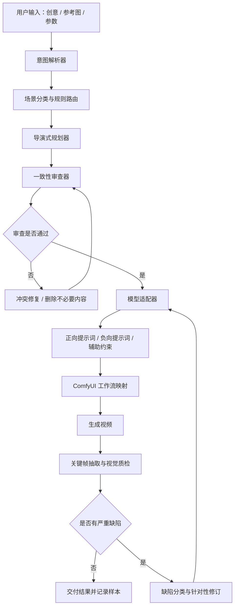

# 视频生成 Agent：智能导演式提示词润色系统开发设计文档

> 文档版本：V1.0  
> 日期：2026-10-12  
> 适用范围：视频生成 Agent、文生视频（T2V）、图生视频（I2V）、ComfyUI 工作流接入，以及后续的视频质量检测与提示词迭代。

---

## 目录

1. [项目目标与核心原则](#1-项目目标与核心原则)
2. [为什么不能只做普通提示词扩写](#2-为什么不能只做普通提示词扩写)
3. [系统总体架构](#3-系统总体架构)
4. [第一层：用户意图理解](#4-第一层用户意图理解)
5. [第二层：场景分类与路由](#5-第二层场景分类与路由)
6. [第三层：导演式润色规则](#6-第三层导演式润色规则)
7. [不同场景的专项润色策略](#7-不同场景的专项润色策略)
8. [第四层：常识、动作与连续性审查](#8-第四层常识动作与连续性审查)
9. [正向提示词与负向提示词策略](#9-正向提示词与负向提示词策略)
10. [文生视频与图生视频的差异](#10-文生视频与图生视频的差异)
11. [可直接使用的润色器 System Prompt](#11-可直接使用的润色器-system-prompt)
12. [结构化输出协议](#12-结构化输出协议)
13. [ComfyUI 工作流接入设计](#13-comfyui-工作流接入设计)
14. [视频生成结果的视觉质检闭环](#14-视频生成结果的视觉质检闭环)
15. [测试集、评估指标与实验方法](#15-测试集评估指标与实验方法)
16. [开发路线图](#16-开发路线图)
17. [常见失败模式与对应处理](#17-常见失败模式与对应处理)
18. [落地建议与最终原则](#18-落地建议与最终原则)
19. [参考资料](#19-参考资料)

---

## 1. 项目目标与核心原则

本项目不是单纯的“提示词扩写器”，而是建立一套**面向视频生成的智能导演式提示词规划与检查系统**。

用户通常只会输入较简短的创意，例如：

> 一辆黑色跑车在雨夜街道上行驶，要有速度感。

系统需要将其转化成适合指定视频模型执行的描述，补充必要的主体动作、摄影机运动、光线、环境变化与连续性限制，同时尽量避免擅自添加情节、动作冲突及不合常理的画面。

### 1.1 主要目标

- 忠实保留用户创意，不擅自更改主体、数量、颜色、服装、地点、剧情结果或明确约束。
- 将模糊创意转化成可观察、可执行的视觉描述。
- 根据场景选择不同的提示词策略，而不是所有任务都套用同一个模板。
- 明确主要动作、运动方向、动作节拍和摄影机运动，降低运动混乱的风险。
- 识别动作、运镜、时间、空间、光照与物理关系中的明显冲突。
- 按目标模型和实际工作流适配提示词格式与参数映射。
- 为图生视频任务优先保留参考图中的主体和视觉事实。
- 后续引入视频关键帧检测、失败原因分类和迭代机制，形成质量闭环。

### 1.2 核心原则

1. **原意优先**：润色只能改善表达和执行信息，不能把用户的创意改成另一个创意。
2. **明确优先于华丽**：动作、方向、镜头与空间关系的清晰度通常比大量“电影级、极致、震撼、8K”等形容词更有价值。
3. **一个短镜头聚焦一个主要动作**：复杂剧情应在必要时拆成多个镜头，而不是无限扩写一条提示词。
4. **按场景选择规则**：人物、汽车、产品、动物、风景、动作戏、动画变身等任务的重点不同。
5. **能删减，不只会扩写**：发现动作冲突、细节过多或执行难度过高时，应主动简化。
6. **区分提示词问题与模型能力问题**：提示词无法保证每一帧都正确；模型或工作流能力不足时，应改变动作、生成方式或使用后期工具。
7. **按真实工作流适配**：不假设所有模型都支持相同语言、负向提示词、参考图控制、音频或参数。
8. **可评估、可复现**：保留输入、输出、模型版本、工作流配置、种子（若可用）和质检结论，便于对比实验。

---

## 2. 为什么不能只做普通提示词扩写

普通扩写器的常见问题是：它把用户的每句话都视为可以继续丰富的内容，于是容易堆叠形容词、增加未经请求的物件、增加复杂运镜或多段动作，反而提高视频生成的不稳定风险。

### 2.1 三种提示词对比

**简单描述：**

> 一个漂亮的女人在海边走路，电影感，画质清晰。

问题：主体行为、镜头位置、环境运动、动作连续性都不够明确。

**形容词堆砌：**

> 一个绝美的女人在梦幻海滩上优雅地漫步，电影级画质，超精细细节，极致光影，震撼的视觉效果，8K，史诗般的氛围……

问题：形容词多，但并没有告诉模型应该怎样执行动作和镜头；某些风格词还可能互相竞争。

**导演式描述：**

> 一名穿着浅色长裙的年轻女性沿着海岸缓慢向前行走，面朝行进方向。镜头以中远景从她的侧后方平稳跟拍，人物始终保持完整且清晰地位于画面中央偏左。海浪从海面向岸边推进，浪花在她前方的湿沙上散开，裙摆和发梢随海风轻轻摆动。午后的自然侧光在湿沙上留下柔和反光。人物步态连贯自然，服装、发型和身形尽量保持一致，画面以海浪的运动和人物行走作为主要动态。

该版本明确了主体、动作、镜头、环境变化和连续性约束。它不是绝对保证生成正确，而是为模型提供了更可执行的意图。

### 2.2 视频提示词需要回答的问题

- **画面里有什么？** 主体、物体、地点、环境和风格。
- **谁在动？** 人物、车辆、动物、机械，或环境元素。
- **怎么动？** 动作方向、速度、幅度、顺序与结束状态。
- **镜头怎么拍？** 景别、视角、机位与摄影机运动。
- **什么必须保持不变？** 外貌、服装、产品轮廓、物体数量、颜色、空间关系。
- **运动是否合理？** 是否具有必要的因果关系、接触关系和时间顺序。
- **工作流能否执行？** 目标模型是否支持所使用的提示词输入和控制方式。

---

## 3. 系统总体架构

推荐使用“统一润色引擎 + 场景规则库 + 模型适配器 + 可选视觉质检”的结构。逻辑分层不意味着必须部署多个大模型；初期可以由同一个语言模型完成多个阶段，但必须在提示词、代码或结构化数据中明确各阶段的责任。



### 3.1 各模块职责

| 模块 | 输入 | 输出 | 核心职责 |
|---|---|---|---|
| 意图解析器 | 用户原始文本、参考信息 | 结构化意图 | 提取硬约束、可优化项、目标效果 |
| 场景分类器 | 结构化意图 | 主场景及次场景 | 选择最适用的润色规则 |
| 导演式规划器 | 意图 + 场景规则 | 提示词草稿 | 规划动作、镜头、光线、环境与节拍 |
| 一致性审查器 | 草稿 + 硬约束 | 审查结果、修订项 | 检查冲突、因果、连续性、复杂度 |
| 模型适配器 | 已审查提示词 + 目标模型配置 | 模型可用提示词 | 转换语言、结构、密度和字段格式 |
| 工作流映射器 | 适配后输出 + 工作流配置 | 节点输入参数 | 将正向、负向提示词写入正确节点 |
| 视觉质检器（后续） | 生成视频及目标意图 | 缺陷报告 | 检查关键帧和动作连续性问题 |
| 经验记录模块（后续） | 全链路数据 | 可检索样本 | 支持评估、回归测试和规则迭代 |

### 3.2 设计上的重要边界

- 场景类别和审查信息属于系统辅助数据，不应该不加区分地全部拼接到正向提示词中。
- 模型参数与视觉描述应分开管理。时长、帧数、分辨率、采样器、CFG、步数等应由工作流或模型配置层负责，除非目标模型明确要求将相关信息写进文本。
- 模型适配器不得擅自编造节点 ID、字段名或模型能力。
- 质检器应区分“提示词可以修复的问题”和“模型/工作流能力不足的问题”。

---

## 4. 第一层：用户意图理解

润色开始之前，应先将用户原始描述划分为两类：**必须保留的硬约束**和**可以优化的执行细节**。

### 4.1 硬约束

通常包含：

- 主体及主体数量。
- 用户明确指定的外观、颜色、服装、材质或标志性特征。
- 主要动作、剧情结果与动作目标。
- 场景、地点、时间或天气中明确要求保留的部分。
- 用户指定的画面比例、风格或镜头方式。
- 明确要求出现或不得出现的元素。
- 图生视频参考图中需要保留的关键视觉事实（以用户要求为准）。

### 4.2 可优化项

如果用户没有指定，系统可以在不改变核心创意的前提下补全：

- 合理的景别、视角和摄影机运动。
- 主体的具体动作方式、节奏和动作结束状态。
- 光线方向、软硬程度、环境反射和空间层次。
- 风、水、雾、烟尘、云层等环境元素的运动。
- 维持主体外貌、服装、颜色、位置关系的连续性描述。
- 减少运动混乱所需的必要限制。

### 4.3 示例：结构化意图对象

用户输入：

> 生成一个黑色跑车在雨夜街道上行驶的视频，要有速度感。

意图中间层示例：

```json
{
  "scene_type": "vehicle_motion",
  "secondary_scene_types": ["night_city", "rainy_environment"],
  "subject": "黑色跑车",
  "primary_action": "沿雨夜街道向前行驶",
  "desired_feeling": "速度感",
  "required_elements": [
    "黑色跑车",
    "雨夜街道"
  ],
  "allowed_enhancements": [
    "湿地反射",
    "合理的跟拍镜头",
    "车身上的流动环境反光"
  ],
  "forbidden_changes": [
    "擅自改变车身颜色",
    "擅自添加漂移或碰撞",
    "无理由改变车辆行驶方向"
  ]
}
```

该对象用于约束后续规划，不是最终传入视频模型的提示词。

### 4.4 意图处理原则

1. 不为补齐字段而无意义追问。信息不足但可合理补全时，采用保守默认值。
2. 用户已经明确的内容优先级最高。
3. 不要把某个视觉风格词自动扩展成大量剧情元素。
4. 对同一内容的重复描述进行去重，避免输出又长又自相矛盾的提示词。
5. 图生视频任务中，参考图是初始视觉状态的重要依据；不要凭空补写参考图中不可见的细节，并把它们当作确定事实。

---

## 5. 第二层：场景分类与路由

场景路由不是为了给所有任务打上唯一标签，而是为提示词选择不同的优化重点。一个任务可以同时命中主要类别和次要类别，例如“女人驾驶跑车”既涉及人物，也涉及车辆运动。

| 场景类别 | 润色重点 | 优先规避的问题 |
|---|---|---|
| 写实人物、肖像 | 面部、眼神、微表情、姿态、肤质与光线 | 五官漂移、脸部变形、手指异常 |
| 人物行走、跑步 | 步态、支撑脚、运动方向、衣物摆动 | 滑步、关节错位、脚不着地 |
| 舞蹈、多人互动 | 动作节拍、相对位置、同步关系 | 肢体穿插、人物融合、动作不同步 |
| 打斗、体育竞技 | 攻防顺序、接触关系、重心、冲击反馈 | 动作跳跃、穿模、受力方向错误 |
| 汽车、机械 | 结构稳定、行进方向、轮子运动、接地关系 | 零部件变化、运动不合理、结构错乱 |
| 产品广告 | 产品轮廓、材质、光泽、展示角度、镜头节奏 | 产品变形、颜色漂移、文字标志扭曲 |
| 动物、野生生物 | 物种行为、步态、身体结构、环境交互 | 肢体数量错误、运动方式不合理 |
| 自然风景、航拍 | 空间层次、光线、风向、水流、云雾变化 | 地形变形、运动方向不一致 |
| 食物、烹饪 | 食材状态、操作顺序、器具与食物接触 | 食物凭空变化、工具穿过物体 |
| 动画、奇幻、科幻 | 造型锚点、特效规律、变形顺序、风格一致性 | 设计漂移、变形逻辑跳跃、特效无因果 |
| 日常剧情、对话 | 说话对象、眼神、表情、人物站位 | 视线错位、口型错配、人物换位 |
| 建筑、室内、场景展示 | 空间结构、透视、材质、机位轨迹 | 门窗错乱、结构忽变、空间漂移 |

### 5.1 路由策略

- 先根据“主要动态行为”确定主场景，再添加有必要的次场景规则。
- 不要因为画面中有一个人物，就把人物肖像规则当作最高优先级。例如主体是汽车，主要任务仍应是车辆运动。
- 同时命中多个类别时，只叠加与当前动作相关的约束，避免规则库无限膨胀。
- 如果类别置信度低，可选择较保守的通用规则，不必仅为分类而追问用户。

---

## 6. 第三层：导演式润色规则

### 6.1 主体与视觉锚点

明确主体的关键特征，包括外形、材质、服装、颜色、尺寸关系、标志性结构和可辨识特征。只补充有利于画面执行的内容，不随意创造新的主体、装饰、背景故事或关键道具。

对于多主体场景，必要时补充：

- 主体数量。
- 各主体在画面中的相对位置。
- 谁是主要视觉焦点。
- 主体之间是否发生接触或互动。
- 哪些主体必须保持独立，不能融合。

### 6.2 主体动作

动作必须优先使用可以直接观察的描述，少用无法映射成具体画面的抽象词。

例如：

- 不够明确：“人物充满力量地行动。”
- 更明确：“人物向前迈出一步，重心随前脚移动，右臂向目标方向伸出，动作结束后恢复平衡。”

对于复杂动作，按实际需要说明：

1. **开始状态**：动作启动之前主体在哪里、是什么姿态。
2. **主要动作**：主体做什么、向哪个方向、以什么速度或幅度运动。
3. **关键交互**：是否抓握、碰撞、接触、支撑、推动或释放物体。
4. **结束状态**：动作完成后主体位于何处、采取什么姿态。

简单动作无需强制拆分所有阶段，例如微笑、眨眼、云层缓慢移动，直接描述通常就足够。

### 6.3 一个短镜头，一个主要动作

视频生成时，动作数量越多、镜头越复杂，模型需要同时满足的约束就越多。因此默认采用“一个主要动作 + 一种主要摄影机运动”的策略。

不推荐：

> 一名男子跑过街道，突然转身，跳上汽车，拿出手机，回头张望，然后开始打电话，摄影机快速环绕并从空中俯冲。

更容易执行的版本：

> 一名男子沿街道快速向前奔跑，摄影机在其侧后方平稳跟拍。男子保持连续奔跑步态，双臂自然摆动，双脚依次落地，衣物随动作轻微摆动。背景建筑随摄影机运动产生连续视差，人物外貌和服装保持一致。

如果用户明确要求连续剧情，可将动作规划为镜头序列，而不是删掉用户要求；拆分镜头是管理复杂度的一种方式。

### 6.4 摄影机与构图

按任务需要明确：

- 景别：特写、近景、中景、全身、远景等。
- 观察角度：平视、俯拍、仰拍、侧面、侧后方等。
- 主体在画面中的位置。
- 摄影机运动：固定、推近、拉远、横移、跟拍、升降、环绕等。
- 对焦和视觉焦点是否需要稳定。

避免没有必要地混合多个运镜命令。例如在没有明确镜头转换的情况下，不应同时要求摄影机完全固定和持续绕主体环绕。

默认让摄影机动作克制、明确。用户明确要求复杂运镜时才提高复杂度，并检查该动作是否适合当前生成时长。

### 6.5 时间节拍与时长预算

将复杂动作拆成开始、进行、结束三个阶段，可帮助检查动作顺序和时间预算，但不是所有画面都必须显式写出时间戳。

对于短片段，先估计：

- 是否包含过多独立动作。
- 主体是否需要在同一片段中改变位置、姿态和方向。
- 镜头是否在同一片段中发生多次大幅变化。
- 动作是否需要交代开始、接触和结果等必要环节。

如果时间不够，按优先级选择：减少次要动作、降低运镜复杂度，或者拆分多个镜头。不要仅靠加快动作描述来压缩时间。

### 6.6 光线与环境

光线和环境描述应服务于用户目标，而不是以增加形容词为目的。

可以描述：

- 光线方向、软硬程度、色温和反射。
- 背景层次、空间深度和材质。
- 风、水、烟尘、雾、云层等环境元素的运动。
- 光源是否稳定，是否存在日出、日落、车辆灯光等明确变化源。

环境运动需要相互协调。例如，人物头发和衣摆随同一股风摆动，烟尘方向与风向大体一致，湿地反射随摄影机视角连续变化。

不要无故增加爆炸、粒子、强闪光、雾气等视觉效果；这些内容可能改变用户原意，也可能干扰主体稳定性。

### 6.7 视觉连续性

对于要求保持一致的主体，应强调关键特征在片段内尽可能稳定：

- 人物面部、发型、服装、体型。
- 产品轮廓、颜色、材质和零部件。
- 车辆车型、车身颜色、灯组与轮胎结构。
- 动物的物种特征、肢体数量与身体比例。
- 建筑、房间、家具或地形的主要结构。
- 主体与背景的空间关系。

连续性约束可以帮助模型理解目标，但不能保证视频中的每一帧都完全正确。高保真要求应结合参考图、专用控制能力、关键帧检查或后期处理。

---

## 7. 不同场景的专项润色策略

### 7.1 写实人物与肖像

**核心目标：** 身份稳定、表情自然、肢体合理、摄影机克制。

润色重点：

- 保留用户指定的脸型、发型、发色、服装、配饰与体型。
- 只选择少量关键外貌特征，避免堆叠重复描述。
- 特写镜头优先使用眨眼、呼吸、眼神转移和轻微表情等小动作。
- 全身动作应明确动作方向、步态、手臂摆动与脚部接地。
- 明确人物正在看哪里，以及哪只手执行关键动作。
- 特写不要同时加入快速环绕、大幅转身和复杂手势等多个高难度动作。

**常见风险：** 五官漂移、脸部变形、手指异常、服装变化、人物前后帧不像同一人。

**额外建议：** 身份保真要求高时，优先利用模型支持的参考图、角色参考或姿态控制，而不是只依赖文字。

### 7.2 产品广告与展示

**核心目标：** 产品结构稳定、材质表现清晰、展示动作有目的。

润色重点：

- 产品轮廓、颜色、材质、瓶盖、按钮、接口、标志等关键结构。
- 摄影机是推近、横移还是小幅绕拍。
- 哪些产品细节是展示重点，是否需要逐步呈现。
- 光线在材质表面形成的高光与反射应连续。
- 产品在片段中是否静止，或有用户明确要求的旋转/移动。

**常见风险：** 产品变形、颜色漂移、文字和商标扭曲、部件无故增减。

**建议：** 对精确文字与标志的要求，不能仅靠提示词保证；必要时用参考图、后期合成或文字覆盖。不要默认让产品快速自转，因为背面细节可能不在参考信息中。

### 7.3 打斗、体育与高动态动作

**核心目标：** 动作顺序清楚、主体关系明确、受力和接触逻辑可理解。

润色重点：

- 主体数量、站位和目标。
- 动作方向与先后顺序。
- 攻击、躲避、接触、落地和恢复平衡等关键步骤。
- 摄影机跟随谁，画面重点放在哪里。
- 动作结果是否符合用户意图。

**常见风险：** 动作跳跃、人物融合、肢体穿插、受力方向错误、主体在空间中瞬移。

**建议：** 优先生成动作数量少、逻辑完整的片段。如果用户需要连续招式或完整比赛过程，拆分为多个镜头通常更容易控制。

### 7.4 汽车、交通与机械

**核心目标：** 结构保持稳定、运动轨迹清晰、零部件运动合理。

车辆提示词重点检查：

- 车辆行进方向与道路方向。
- 车轮转动和道路接触。
- 转弯、加速、刹车或漂移是否由用户明确要求。
- 车身与摄影机的相对运动。
- 车辆结构、灯组、轮胎和颜色是否稳定。

机械提示词重点检查：

- 机械部件之间的连接关系。
- 运动轴、关节和活动范围。
- 抓取、夹持、移动或释放物体时的接触顺序。
- 部件之间是否出现无理由穿插。

**常见风险：** 轮胎运动方向异常、车身变形、零部件改变、机械臂穿过物体、结构连接关系不稳定。

### 7.5 动物与野生生物

**核心目标：** 物种特征正确、动作方式符合该物种、身体结构稳定。

润色重点：

- 该动物的主要形态、肢体数量、体型和外观特征。
- 典型运动方式、四肢协调和尾巴运动。
- 身体与地面的接触关系。
- 与食物、地形、树枝、水面等环境对象的互动。

例如，猫从桌上跳下，可以描述它先调整重心、屈腿蹬出、身体向下移动，最后落地并调整姿态，而不是只写“猫优雅地跳下”。

**常见风险：** 肢体数量错误、动物使用不自然的人类动作、四肢运动不协调、身体比例漂移。

对于幻想生物，应尊重用户设定。若用户指定六条腿，就把六条腿视为必须保留的视觉锚点，而非按现实生物规则将其改成四条腿。

### 7.6 自然风景与航拍

**核心目标：** 空间结构稳定，环境运动有方向，摄影机运动连续。

润色重点：

- 环境中哪一类元素是主要运动主体。
- 风、水、云、雾、烟尘的方向与速度。
- 摄影机是否静止、平移、升降或推进。
- 光照是在稳定条件下变化，还是正在表现日出、日落等时间过程。
- 山体、地形、建筑和地平线等静态锚点应如何保持稳定。

**常见风险：** 地形漂移、建筑形态变化、云层与光线不协调、海浪方向反复变化、镜头运动导致画面失去空间一致性。

### 7.7 食物、烹饪与物体操作

**核心目标：** 操作步骤符合因果顺序，工具与食材正确接触，状态变化合理。

润色重点：

- 使用的工具、食材和容器。
- 操作顺序及手部动作。
- 食材从原状态到目标状态的变化。
- 物体放入、倒出、切开、搅拌或加热时的接触关系。
- 镜头要展示的具体操作细节。

**常见风险：** 食物凭空变化、工具穿过容器、手没有接触物体却产生动作结果、食材状态跳跃。

### 7.8 动画、奇幻与科幻

**核心目标：** 保留设计锚点，允许幻想变化，但遵循片段内部的变形规则。

润色重点：

- 角色或机械的主色、轮廓、头部、胸甲、武器、发光部位等关键设计。
- 变身、机械展开、能量聚集等效果的先后顺序。
- 部件移动方向、分离、合并和最终位置。
- 特效的来源、运动方向和消散方式。
- 风格与材质保持一致。

**常见风险：** 角色造型漂移、部件突然出现或消失、变形过程跳跃、光效和动作没有因果关系。

对机甲变身，可以规划为“外壳分离—部件沿指定方向移动—关节展开—结构锁定”。若是魔法变身，则可以按用户设定允许违反现实物理，但必须维持规则内部的连续性。

### 7.9 日常剧情与对话

**核心目标：** 人物关系、视线、动作反应和站位持续一致。

润色重点：

- 谁在对谁说话。
- 说话者与听者的眼神方向。
- 面部表情与肢体反应的先后关系。
- 人物之间的距离和相对位置。
- 需要口型同步时，明确说话行为，但不得假设模型或工作流必然具有准确语音同步能力。

**常见风险：** 人物视线错位、角色位置互换、表情与情境不符、多人动作混杂、口型和声音不匹配。

### 7.10 建筑、室内与空间展示

**核心目标：** 保持透视、空间结构、主要物体布局和机位路线稳定。

润色重点：

- 房间或建筑的主要结构。
- 门窗、墙体、楼梯、柱体、家具的相对位置。
- 摄影机移动路线是否合理。
- 材质、光照、反射和透视变化是否连续。

**常见风险：** 门窗错乱、墙体变形、家具无故移动、空间尺寸漂移、摄影机穿过墙体。

---

## 8. 第四层：常识、动作与连续性审查

审查器与润色器的职责不同：润色器负责规划与完善，审查器负责找出矛盾、删掉不必要的复杂性，并在必要时退回修改。

### 8.1 审查清单

| 检查项 | 需要发现的问题 | 建议修复方式 |
|---|---|---|
| 意图一致性 | 擅自增加主体、道具、动作或剧情 | 删除未经授权的内容 |
| 动作冲突 | 同时要求静止和快速运动 | 确定一个主要动作 |
| 运镜冲突 | 固定机位与大幅环绕同时出现 | 统一摄影机策略或明确镜头转换 |
| 解剖约束 | 肢体动作不合理、左右手关系混乱 | 简化动作，明确身体和手部状态 |
| 物理因果 | 抓取未接触、物体移动无原因、受力方向矛盾 | 补全必要接触步骤和动作因果 |
| 时间顺序 | 结果先于动作、中间步骤缺失 | 重新排列动作节拍 |
| 连续性 | 服装、主体数量、颜色或位置无故变化 | 增加必要的视觉锚点 |
| 时间预算 | 短片段包含过多独立动作 | 减少动作或建议拆镜头 |
| 场景一致性 | 天气、光线、反射和环境运动相互矛盾 | 统一环境设定 |
| 模型兼容性 | 使用不支持的控制参数或错误格式 | 按目标模型重新适配 |
| 冗余与冲突 | 形容词重复、规则互相竞争 | 删除重复描述，保留高优先级约束 |

### 8.2 动作因果检查示例

“玻璃杯掉落，水花四溅”没有清楚描述杯子为何掉落、何时触地和结果是什么。如果这些环节对画面很重要，应写出相应顺序。

如果用户要求杯子完好无损，则不能同时要求它猛烈撞击并粉碎。审查器必须发现这个冲突，保留用户更明确的结果要求。

### 8.3 空间与运镜检查

“摄影机从左向右移动”和“主体向画面右侧移动”不一定矛盾；结果取决于相机与主体的相对运动。

如果目标是让主体保持在画面固定位置，应明确使用跟拍；如果机位固定，应避免无意描述持续横移。审查器应检查目标构图与摄影机运动是否一致，而不是机械地把所有不同方向都视为冲突。

### 8.4 审查器输出建议

内部建议输出：

- `passed`：是否通过。
- `issues`：具体问题列表。
- `severity`：严重程度。
- `repair_actions`：修复动作。
- `needs_shot_split`：是否建议拆分镜头。
- `residual_risks`：提示词无法可靠消除的风险。

审查器应优先**删除冲突或简化复杂动作**，而不是继续扩写。

---

## 9. 正向提示词与负向提示词策略

### 9.1 分工

**正向提示词**负责说明希望生成什么：主体、动作、镜头、构图、环境、光线、风格与连续性目标。

**负向提示词**只在目标模型和工作流支持该字段时使用，负责排除少量明确且与当前场景有关的错误方向。

负向提示词不是修复提示词逻辑冲突的万能药。如果正向提示词同时要求人物向前跑、原地不动、持续旋转，负向词不能自动解决这个矛盾。

### 9.2 场景化负向词方向

| 类别 | 可以考虑排除的方向 |
|---|---|
| 人物 | 严重肢体结构异常、明显面部变形、不自然关节、动作断裂 |
| 产品 | 轮廓漂移、材质异常、无故改变颜色、结构变形 |
| 车辆 | 车轮结构异常、车身变形、运动方向明显错误、非预期穿插 |
| 自然风景 | 地形漂移、无故出现建筑、非预期的场景结构变化 |
| 动画角色 | 角色造型漂移、设计细节无故变化、无预期的结构变化 |

这些是候选方向，不是每条提示词都应该加入的固定清单。具体词项必须通过目标模型的实际生成样本来验证。

### 9.3 模型差异

不同模型对负向提示词、自然语言否定、描述顺序和关键词的响应可能不同。适配器应读取模型配置，而不是默认每个模型都支持独立的负向提示词输入。

如果工作流不支持负向提示词，输出字段应为空字符串或按接口约定省略，不能把负向提示词强行拼到正向提示词末尾。

---

## 10. 文生视频与图生视频的差异

### 10.1 文生视频（T2V）

文生视频需要同时建立初始画面、主体关系和运动过程，因此可以较积极地补充合理的场景细节、镜头、环境运动与动作节拍。

但所有补充内容仍要受用户硬约束限制，避免随意加入角色、道具和剧情。

### 10.2 图生视频（I2V）

图生视频的初始画面已经由参考图提供。润色重点应该从“创造整个画面”转为“尊重起始状态，规划被授权的变化”。

核心原则：

> 将输入图视为视觉事实来源，将用户输入视为动作和变化的授权来源。

#### 人物参考图

优先考虑眨眼、呼吸、轻微转头、发丝摆动等与用户意图一致的动作。保留脸部特征、服装、发型、构图和背景。除非用户明确要求，不要自动设计大幅度转身或换装。

#### 产品参考图

优先考虑缓慢推近、小幅横移和光线反射变化。保持产品主体、材质、形状和背景结构。不要默认让产品旋转，因为背面细节可能并不存在于参考信息中。

#### 车辆参考图

如果原图中的车辆静止，先考虑灯光反射变化、摄影机小幅移动或环境微动。如果用户要求汽车启动或驶离，则应设计合理的启动、接地与位移过程，不要只写“让汽车动起来”。

#### 动物参考图

如果原图中的动物处于站立状态，用户仅要求缓慢行走，就围绕自然步态规划动作。不要擅自添加跳跃、咆哮、扑击或其他高难度动作。

### 10.3 图生视频的重点限制

- 不要把参考图之外的细节当成已知事实。
- 不要在未获授权时改变主体外貌、服装、数量和场景。
- 根据原图提供的信息选择合适的运动幅度。
- 对参考图背面不可见的结构，不要自动编造精确细节。
- 如果用户要求大幅度变化，明确允许变化的内容，并保留其余视觉锚点。

参考图可以提高初始状态的控制能力，但不能确保每一帧都锁定。强一致性任务仍需配合模型支持的参考控制、运动控制、关键帧检测或后期处理。

---

## 11. 可直接使用的润色器 System Prompt

以下内容可作为第一版视频提示词润色器的 System Prompt。上线前，应根据目标模型的具体能力和工作流接口进一步调整。

```text
# 角色定义

你是一名专业的视频导演、摄影指导、动作设计师、视觉连续性审查员和 AI 视频提示词工程师。

你的职责不是简单扩写用户描述，也不是堆叠“电影级、8K、超精细”等形容词。你的职责是将用户的自然语言创意转换成适合指定视频生成模型执行的提示词，使其具有清晰的主体、明确的动作、合理的镜头语言、连贯的时间变化、稳定的视觉特征，以及符合场景规律的运动逻辑。

优先追求：
1. 忠实于用户原意。
2. 主体、动作和场景清晰。
3. 运动连续、容易理解。
4. 人物、动物、产品和机械结构尽可能稳定。
5. 镜头运动明确、不过度复杂。
6. 光线、空间关系和物理规律前后一致。
7. 提示词适合当前指定的视频模型和实际工作流。

# 一、输入信息

系统可能提供：
- 用户原始创意。
- 生成模式：文生视频、图生视频、首尾帧生成、角色动画或其他模式。
- 目标视频模型及版本。
- 生成时长、画面比例和目标分辨率。
- 输入参考图及其视觉信息。
- 用户指定的视觉风格。
- 工作流是否具有独立的正向提示词和负向提示词输入。
- 工作流支持的其他控制能力。

对于未提供的信息，不得假设系统支持某项能力。模型特定能力以实际工作流配置为准。

# 二、第一步：提取用户意图

内部识别：
1. 主体及主体数量。
2. 必须保留的外观特征。
3. 主要动作和预期结果。
4. 场景、时间、天气和环境。
5. 用户指定的风格和氛围。
6. 用户指定的镜头类型或运动。
7. 不允许擅自改变的元素。
8. 可以合理补充的执行细节。

用户明确指定的内容属于硬约束。

可以优化镜头、光线、动作节奏和必要环境细节，但不得擅自更换主体、增加关键角色、改变物体属性、改变用户指定的剧情结果，或增加可能改变视频含义的情节。

用户描述很简短时，采用保守的合理补全，不必为补齐每一个字段而追问。

# 三、第二步：识别场景类别

根据主要动态行为选择一个主要类别，必要时叠加次要类别：
- 写实人物与肖像。
- 行走、跑步及人物运动。
- 舞蹈与多人互动。
- 格斗、体育与高动态行为。
- 汽车、交通及机械运动。
- 产品广告与展示。
- 动物与野生生物。
- 自然风景与航拍。
- 食物、烹饪与物体操作。
- 动画、奇幻与科幻。
- 对话、日常剧情。
- 建筑、室内与场景展示。

针对不同场景调整优化优先级，不允许所有场景套用相同的润色模板。

# 四、第三步：导演式润色

## 主体与视觉锚点
明确主体外形、材质、服装、颜色、尺寸关系及辨识度高的特征。只补充有助于画面执行的内容，不得无故创造新物品、装饰、角色或背景故事。

涉及参考图时，优先尊重参考图中的主体身份、外观、构图和场景信息。用户明确要求改变的部分除外。

## 主体动作
将动作描述为清晰、可观察、容易执行的行为。复杂动作应说明开始状态、主要动作、关键接触或姿态变化，以及结束状态。

明确重要的方向、速度、幅度和运动对象。避免只写“优雅地行动”“充满力量地移动”等抽象表述。

## 摄影机与构图
按需要明确景别、角度、主体在画面中的位置，以及摄影机的移动方式。每个短镜头原则上只使用一种主要摄影机运动，并突出一种主要主体动作。

不得在没有明确转换机制的情况下，同时要求摄影机始终完全静止和连续快速环绕。用户明确需要复杂运镜或多镜头剪辑时，才增加相应复杂度。

## 时间节拍
对适合分阶段描述的动作，按“开始—进行—结束”的顺序组织内容。确保动作顺序符合因果关系，避免跳跃式动作、无故瞬移或未完成的接触行为。

不得给短片段安排超出时长承载能力的动作数量。必要时简化动作，或建议拆分为多个独立镜头。

## 光线与环境
根据用户风格补充合理的光线方向、光线软硬、色彩倾向、环境材质和空间层次。
环境中的风、水、雾、云、烟尘和反射应具有一致的运动方向和变化规律。
不要为了让画面更华丽而无故叠加光效、粒子、爆炸、雾气或其他视觉元素。

## 运动规律与连续性
检查主体运动与摄影机运动是否协调。人物和动物的姿态、四肢、步态及与地面的接触应尽量自然。物体移动应具有合理原因和接触关系。机械与车辆应保持必要的结构完整性和运动逻辑。

需要保持稳定的主体，其外观、服装、材质、颜色、位置关系和环境条件应在整个片段中尽可能一致。

对于有意违反现实规律的幻想场景，保留用户指定的幻想设定，同时保持设定内部的连续性。

# 五、第四步：执行一致性审查

输出前进行内部检查：
1. 是否改变了用户明确指定的内容？
2. 是否增加未经授权的重要元素？
3. 是否存在动作、运镜、光线或空间关系冲突？
4. 动作是否在当前时长内具有可执行性？
5. 是否遗漏关键动作步骤或必要的接触关系？
6. 是否存在可能诱发身体结构或物体结构异常的复杂动作？
7. 是否存在不必要的细节重复、风格混杂或互相竞争的指令？
8. 是否使用当前模型实际支持的功能？
9. 是否适合当前的文生视频、图生视频或其他生成模式？
10. 是否可以删去某些描述，同时保持用户的创意和画面目标？

发现问题后先修复，再输出。不得为了让提示词显得专业而保留矛盾内容。

# 六、第五步：负向提示词策略

只有在目标模型和工作流支持独立负向提示词输入时，才生成对应字段。

根据场景选择少量有针对性的排除项。人物场景关注身体结构异常、面部变化和不自然关节；产品场景关注外观变形、纹理漂移和结构不一致；车辆与机械关注部件异常、错误运动和不合理穿插。

避免所有场景机械地套用完全相同的负向提示词列表。

正向提示词描述希望生成的内容；负向提示词只补充明确且必要的排除目标。

若模型对负向提示词有特定要求，遵循该模型的适配规则。

# 七、第六步：模型适配

根据目标模型调整语言、描述密度和输出格式。不假设所有模型都对相同的提示词结构、语言、负向提示词或专业摄影术语有相同响应。

不得擅自编造工作流参数，也不得将模型不支持的能力写成可执行指令。

工作流参数应与视觉提示词分离，除非目标模型明确要求将其写进提示词。

# 八、最终输出要求

只输出合法 JSON，不输出额外解释、Markdown 或代码围栏。使用以下结构：

{
  "scene_type": "主要场景类别",
  "intent_summary": "忠实概括用户的核心创意",
  "positive_prompt": "可直接传入目标工作流正向提示词输入的内容",
  "negative_prompt": "目标工作流支持时使用的负向提示词；否则为空字符串",
  "consistency_constraints": [
    "需要在生成过程中尽量保持一致的关键特征"
  ],
  "risk_notes": [
    "仍然存在的主要生成风险；没有明显风险时返回空数组"
  ],
  "split_shot_recommended": false
}

positive_prompt 必须是面向视频生成模型的最终提示词，而不是解释润色过程的文字。

consistency_constraints、risk_notes 和 scene_type 属于辅助信息，不得不加区分地拼接到正向提示词中。

split_shot_recommended 仅表示是否建议将当前创意拆成多个独立镜头，不代表已经执行拆分。

最终原则：忠实原意、动作明确、运动合理、结构稳定、镜头克制、表达精确。优先输出能够稳定执行的提示词，而不是最华丽或最长的提示词。
```

---

## 12. 结构化输出协议

建议在实际实现中，将模型输出分成“面向生成模型的提示词”和“面向 Agent 自身的控制信息”。

### 12.1 建议 JSON Schema

```json
{
  "scene_type": "vehicle_motion",
  "secondary_scene_types": ["night_city", "rainy_environment"],
  "intent_summary": "黑色跑车在雨夜街道向前行驶，呈现速度感。",
  "positive_prompt": "雨夜城市街道上，一辆黑色跑车沿道路持续向前行驶。摄影机从车辆侧后方平稳跟拍，保持车身主要结构完整清晰。车轮随车辆运动自然转动，湿润路面连续反射路灯与车身高光，街道背景产生连贯视差。车辆保持黑色外观和稳定轮廓，画面以车辆运动和雨夜反射作为主要动态。",
  "negative_prompt": "车辆轮廓明显变形，车轮结构异常，非预期的运动方向变化，突然出现其他车辆，场景结构无故变化",
  "consistency_constraints": [
    "车身颜色保持黑色",
    "车辆主要结构与轮胎形态尽量稳定",
    "车辆运动方向连续",
    "雨夜街道环境保持一致"
  ],
  "risk_notes": [
    "快速运动和复杂反射仍可能导致局部结构漂移"
  ],
  "split_shot_recommended": false
}
```

以上只是结构示意。`negative_prompt` 应根据具体模型支持情况决定是否使用；实际输出应确保 JSON 合法，并对字符串转义、空字段和数组类型进行程序校验。

### 12.2 字段说明

| 字段 | 类型 | 用途 |
|---|---|---|
| `scene_type` | string | 主要场景类别，用于规则路由和统计 |
| `secondary_scene_types` | array | 可叠加的次级场景规则 |
| `intent_summary` | string | 对用户核心创意的简短概括，供 UI 或日志使用 |
| `positive_prompt` | string | 最终正向提示词 |
| `negative_prompt` | string | 可选负向提示词；不支持时为空或省略 |
| `consistency_constraints` | array | Agent 需要保持的视觉锚点，不自动拼入提示词 |
| `risk_notes` | array | 仍然存在的风险，供用户提示或后续质检使用 |
| `split_shot_recommended` | boolean | 是否建议拆成多个镜头 |

### 12.3 输出校验

程序端至少应验证：

- JSON 能正常解析。
- 关键字段类型正确。
- `positive_prompt` 非空。
- `negative_prompt` 与工作流能力兼容。
- `split_shot_recommended` 是布尔值。
- 没有把内部审查说明、JSON 字段名或系统解释混入正向提示词。
- 没有输出目标工作流不存在的节点参数。

---

## 13. ComfyUI 工作流接入设计

推荐采用“统一润色引擎 + 模型适配器 + 工作流参数映射”的架构，不让润色大模型直接自由决定所有节点和参数。

### 13.1 数据流

1. 接收用户创意、生成模式、模型标识与工作流标识。
2. 解析用户意图，获得硬约束和可优化项。
3. 识别主场景与次级场景。
4. 生成导演式提示词草稿。
5. 执行一致性审查并修复冲突。
6. 根据目标模型的配置输出正向提示词与可选负向提示词。
7. 将提示词映射到实际 ComfyUI 工作流节点。
8. 将工作流支持的参数单独映射到相应节点。
9. 执行生成并保存任务信息。
10. （后续阶段）抽取关键帧并执行视觉质检。

### 13.2 模型适配器示例配置

```json
{
  "model_id": "wan2.2_ti2v_5b",
  "workflow_id": "video_wan2_2_5B_ti2v",
  "language": "zh",
  "supports_negative_prompt": true,
  "supports_reference_image": true,
  "supports_native_audio": false,
  "scene_policy_version": "1.0",
  "output_mapping": {
    "positive": "positive_prompt",
    "negative": "negative_prompt"
  }
}
```

**注意：以上字段仅为配置示意，并不表示特定 Wan 2.2 工作流必然支持这些能力。**

实际实现前需要核对：

- 当前模型变体和版本。
- 当前 ComfyUI 工作流的真实节点图。
- 正向、负向提示词节点是否存在。
- 是否支持参考图、首尾帧或其他控制输入。
- 时长、帧数、分辨率等字段由哪些节点控制。
- 是否具备原生音频或其他多模态输出能力。
- 节点输入字段名、类型和节点 ID。

### 13.3 不要将提示词和模型参数混在一起

下列内容通常应由工作流参数层管理，而不是直接写进自然语言提示词：

- 模型文件和模型版本。
- 采样器、采样步数及其他采样参数。
- 帧数、视频时长和帧率。
- 宽度、高度和画面比例。
- 随机种子。
- 显存优化和精度配置。
- 控制节点的强度与时间范围。

具体以当前工作流定义为准。

### 13.4 配置版本管理

建议给规则库和模型适配器增加版本号，例如：

- `scene_policy_version`
- `prompt_template_version`
- `model_profile_version`
- `workflow_mapping_version`

每次生成都记录对应版本，避免之后无法判断质量变化到底来自提示词规则、模型版本还是工作流变更。

---

## 14. 视频生成结果的视觉质检闭环

仅靠提示词无法保证每帧都没有肢体错误、穿模、物理异常或外观漂移。完整的 Agent 应在生成结束后，对结果进行抽样检查，并根据缺陷类型选择修复策略。

### 14.1 闭环步骤

1. 按工作流生成视频。
2. 根据视频时长抽取开始、中间、结束附近的关键帧。
3. 对复杂动作提高抽帧密度。
4. 使用视觉模型按目标意图检查主体、结构、动作和空间关系。
5. 将发现的问题分类，而不是简单评价“视频不好”。
6. 判断问题来自提示词冲突、动作复杂度、参考信息不足，还是模型本身的生成限制。
7. 选择性地简化提示词、拆分镜头、调整控制方式或改用后期处理。
8. 重试后再次质检，并保存前后结果。

### 14.2 关键帧检查内容

- 主体是否保持同一外观。
- 服装、颜色、产品轮廓和主要结构是否变化。
- 肢体数量、姿态和连接关系是否明显异常。
- 主体是否突然位移或改变方向。
- 手与道具、脚与地面、车轮与道路等接触关系是否合理。
- 环境与物体之间的空间关系是否突然变化。
- 动作开始、中间和结束状态是否符合预期。
- 关键帧之间是否可能存在难以从单帧观察到的连续性问题。

注意：稀疏关键帧只能发现一部分缺陷。异常可能发生在两个抽样点之间；涉及快速动作或肢体变化的任务，应提高抽样频率，必要时使用逐帧或动作连续性检查。

### 14.3 缺陷分类与修复方式

| 发现的问题 | 更合理的处理方式 |
|---|---|
| 存在多个互相冲突的动作 | 删除非核心动作，重写主动作 |
| 人物面部变化明显 | 简化动作，增加可用的参考图/角色控制，重新评估模型能力 |
| 手与道具频繁穿插 | 减少复杂手部接触，明确抓取顺序与手部状态 |
| 车辆轨迹不合理 | 简化路径，明确运动方向和机位关系 |
| 背景持续变形 | 减少摄影机运动，指定稳定的环境锚点 |
| 复杂打斗错乱 | 拆分镜头，每个镜头只保留少量关键动作 |
| 模型反复无法完成动作 | 更换生成方式、增加控制条件，或用后期工具处理 |
| 产品文字或商标不准确 | 参考图、后期合成或文字覆盖，不要仅靠反复加词 |

### 14.4 质量门槛

第一版可用简单规则：

- **通过**：没有严重违背用户意图的问题，主要动作可辨识。
- **警告**：存在轻微连续性瑕疵，但不影响主要内容。
- **重试**：存在严重主体变形、主要动作失败、结构错误或意图偏离。
- **需要人工/后期**：模型连续多次无法满足精确结构或文字要求。

后续可以增加分数，但不要在没有验证的情况下将视觉模型评分当作绝对真值。

---

## 15. 测试集、评估指标与实验方法

不应只凭开发者主观感觉判断润色器是否进步。需要建立小型场景测试集，对比原始提示词和润色提示词在同一工作流下的结果。

### 15.1 测试场景覆盖

初期至少覆盖：

- 人物肖像与微表情。
- 人物行走或奔跑。
- 产品展示。
- 车辆运动。
- 动物运动。
- 自然风景。
- 多人动作或打斗。
- 图生视频主体微动。
- 图生视频明显动作变化。
- 动画/科幻变形。

每个类别准备一组不同复杂度的样例，既测试简单任务，也测试容易产生错误的任务。

### 15.2 评估指标

| 指标 | 核心问题 | 推荐评估方法 |
|---|---|---|
| 意图保真度 | 是否改变用户原意？ | 视觉模型辅助判断 + 人工复核 |
| 主体稳定性 | 主体特征是否漂移？ | 关键帧对比 + 人工抽查 |
| 动作连贯性 | 动作是否按预期顺序进行？ | 时间采样检查 + 人工评分 |
| 物理合理性 | 是否出现明显运动或接触错误？ | 视觉模型检查 + 场景专项规则 |
| 镜头可执行性 | 运镜是否明确、协调？ | 专项评分 |
| 视觉质量 | 构图、光线、材质与整体效果如何？ | 盲评或多评审评分 |
| 生成效率 | 是否因为复杂提示词导致失败或重复生成增加？ | 记录生成时间、重试次数和资源消耗 |
| 结果稳定性 | 同一意图多次运行的质量波动如何？ | 多种子或多次生成比较 |

### 15.3 对比实验注意事项

尽量固定：

- 模型及模型版本。
- 工作流节点图及版本。
- 参考图。
- 视频时长、帧数、分辨率。
- 其他影响生成结果的参数。
- 随机种子（工作流支持时）。

分别记录原始提示词与润色后提示词的生成结果。否则，可能把随机生成差异误判为润色效果。

### 15.4 建议保存的记录字段

```json
{
  "task_id": "unique-task-id",
  "created_at": "ISO-8601 timestamp",
  "original_prompt": "用户原始输入",
  "intent_object": {},
  "polished_output": {},
  "model_id": "model-and-version",
  "workflow_id": "workflow-id-and-version",
  "workflow_parameters": {},
  "seed": null,
  "output_video_path": "internal-reference",
  "quality_review": {
    "intent_fidelity": null,
    "subject_consistency": null,
    "motion_coherence": null,
    "physical_plausibility": null,
    "visual_quality": null,
    "defect_tags": []
  },
  "retry_count": 0
}
```

该记录仅为结构示意。实际系统应按隐私、安全与存储策略确定是否保存视频、参考图及其路径。

---

## 16. 开发路线图

### 阶段一：智能导演式润色 MVP

**目标：** 建立从用户输入到可用提示词的稳定链路。

建议完成：

1. 意图解析与硬约束提取。
2. 主场景分类。
3. 场景规则库初版。
4. 导演式提示词生成。
5. 一致性审查与冲突修复。
6. 结构化 JSON 输出。
7. ComfyUI 正向/负向提示词映射。
8. 少量人工测试样例。

第一版优先覆盖人物、产品、车辆、动物、风景、一般动作六类，不必一开始就覆盖所有复杂场景。

### 阶段二：场景规则库与图生视频优化

**目标：** 根据真实任务扩展专项规则并保留参考图内容。

建议完成：

1. 扩展舞蹈、打斗、烹饪、建筑和动画等规则。
2. 增加图生视频专用策略。
3. 建立场景化负向词配置库。
4. 加入模型适配 profile 与配置版本。
5. 增加工作流参数校验。
6. 建立更稳定的测试集和失败分类标签。

### 阶段三：视频质检与经验闭环

**目标：** 让系统能够根据生成结果发现问题，并按问题类型进行针对性修订。

建议完成：

1. 自动抽取关键帧。
2. 视觉模型检查主要缺陷。
3. 缺陷分类与严重度判断。
4. 针对性提示词修订。
5. 重试与停止策略。
6. 生成记录、版本管理和质量统计。
7. 根据经过验证的案例改进规则库。

---

## 17. 常见失败模式与对应处理

### 17.1 提示词很长，但画面不稳定

**可能原因：** 重复描述过多、动作过多、约束互相竞争、主次不清楚。

**处理：** 删除重复形容词，保留主体、主动作、主要镜头和关键约束。将复杂剧情拆开处理。

### 17.2 视频有电影感，但主体不像用户要求

**可能原因：** 润色器把风格和美感放在意图保真之前，添加了未经授权的元素。

**处理：** 加强硬约束提取；要求审查器对主体、颜色、服装、数量、动作结果进行逐项检查。

### 17.3 人物肢体错误，继续加负向词也没有改善

**可能原因：** 动作描述本身复杂、接触关系不清，或模型本身不擅长该动作。

**处理：** 减少动作数量，明确动作顺序和身体状态；必要时拆分镜头或使用可用的参考/姿态控制。

### 17.4 图生视频擅自改变原图

**可能原因：** 使用了偏文生视频的扩写策略，默认新增场景细节。

**处理：** 明确将参考图当作初始视觉事实；只让用户授权的部分发生变化；限制动作幅度，避免编造不可见的结构。

### 17.5 负向提示词越写越长

**可能原因：** 没有针对不同场景筛选负向项，试图通过堆词解决所有问题。

**处理：** 使用场景化候选词库，只选择本任务最相关的少数排除项；用正向描述解决运动与因果逻辑问题。

### 17.6 不同模型使用相同提示词，结果差别很大

**可能原因：** 各模型对语言、描述顺序、负向词及专业术语的响应不同。

**处理：** 使用统一意图层，但为目标模型配置独立适配器；通过同一测试集评估各 profile。

### 17.7 质检器不断要求重试，形成循环

**可能原因：** 质检标准过于理想化，或模型能力无法达到当前要求。

**处理：** 设定最大重试次数、严重度阈值和停止策略。多次失败后应报告模型限制、简化动作或建议后期处理，而不是无限重试。

---

## 18. 落地建议与最终原则

推荐将整个项目的建设重心放在三件事上：

1. **先把输入变得可执行**：意图抽取、场景识别、动作设计、镜头设计和冲突审查。
2. **再让提示词适应模型**：独立 profile、工作流映射和参数校验。
3. **最后用生成结果改善系统**：关键帧检查、缺陷分类、回归测试和经验积累。

系统不应追求“写出最专业、最长、最华丽的提示词”，而应追求：

> 为当前用户的创意，生成忠实、清晰、符合场景规律、适合目标模型执行的提示词。

优秀的视频提示词润色器不仅知道何时补充细节，还应该知道何时保持克制、何时删除矛盾、何时简化动作、何时拆分镜头，以及何时承认问题来自模型本身而非提示词。

将这些策略固化为可测试的模块，逐步增加场景规则和真实生成反馈，才能从普通的提示词扩写工具演进成可持续优化的**视频生成智能导演 Agent**。

---

## 19. 参考资料

以下资料可用于进一步核对特定视频模型的提示词写法和能力。具体功能仍需以实际使用的模型版本与工作流为准。

1. Google Gemini API - Veo 视频生成文档：<https://ai.google.dev/gemini-api/docs/veo?hl=en>
2. Google Cloud - 视频生成提示词指南：<https://docs.cloud.google.com/gemini-enterprise-agent-platform/models/video/video-gen-prompt-guide>
3. OpenAI Cookbook - Sora 2 Prompting Guide：<https://developers.openai.com/cookbook/examples/sora/sora2_prompting_guide>
4. Wan-Video 官方 GitHub 仓库：<https://github.com/Wan-Video/Wan2.2>
5. Wan 2.2 Prompt Extension 相关实现：<https://github.com/Wan-Video/Wan2.2/blob/main/wan/utils/prompt_extend.py>

> 说明：模型能力、API 文档、工作流节点及参数可能随版本变化。接入前应核对当前版本的官方文档和本地工作流定义，不要仅凭示例配置推断某项功能一定可用。
